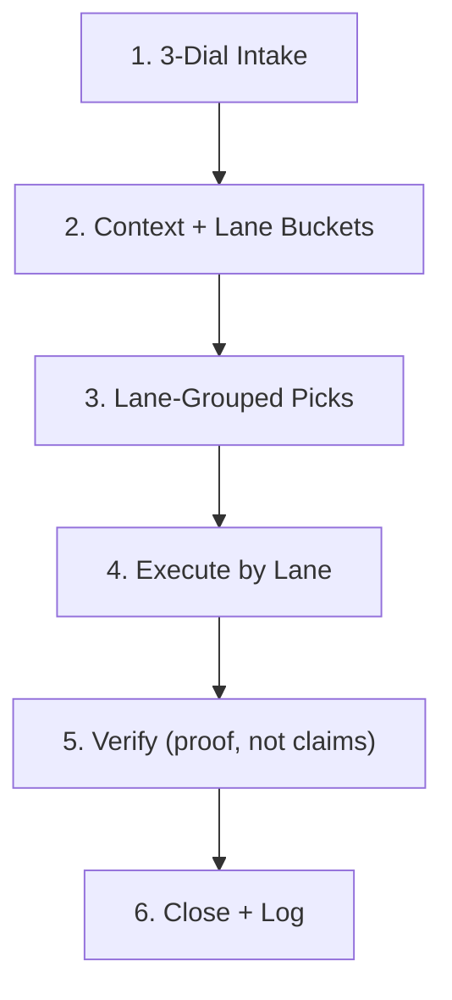

# Next Action: Pick, Execute, Verify, Close

The execution half of the task lifecycle per [ADR-0033](../../../decisions/0033-next-action-mindless-triage-and-build-ritual.md) and [ADR-0065](../../../decisions/0065-task-lifecycle-consolidation-and-delegation-gate.md). {{OPERATOR_NAME}} types `/next-action` (or `/current-action`) with zero context; this ritual picks the highest-leverage work across all five lanes, runs what {{AIOS_NAME}} or Hermes can run, pulls {{OPERATOR_NAME}} in only where the gate says it must, and logs every close. Capture and routing live in [`task-management`](../task-management/SKILL.md).



---

### Stage 1: 3-Dial Intake

Skip when {{OPERATOR_NAME}}'s prompt already gives time, energy, and domain (e.g. `/next-action 45m high AIOS`). Otherwise open with exactly:

```markdown
❓ **Q1** - **Session Dials**:
- **Time:** [A] 15-30m | [B] 45-90m | [C] 2+ hrs
- **Energy:** [A] High (deep build) | [B] Medium (refactor/docs) | [C] Low (admin/chores)
- **Domain:** [A] AIOS | [B] Personal / home / PC | [C] {{BUSINESS_NAME}}

Reply with 3 letters (e.g. `B A A`).
```

### Stage 2: Context + Lane Buckets

```powershell
pwsh -NoProfile -File scripts/Get-NextActionContext.ps1 -TimeBlock <Quick|Focus|Deep> -Energy <High|Medium|Low> -Domain <AIOS|Personal|{{BUSINESS_NAME}}> -Json
pwsh -NoProfile -File scripts/Send-TaskToHermes.ps1          # dry run: the ready Hermes batch
pwsh -NoProfile -File scripts/Send-TaskToHermes.ps1 -Sync    # pull finished cards into Awaiting Review
pwsh -NoProfile -File scripts/Get-Tasks.ps1 -Status 'Awaiting Review'
```

Bucket open tasks by `lane:`. Also surface unlogged gaps from git momentum, dirty tree, and untriaged captures; turn any real gap into a task via `New-Task.ps1` before recommending it.

### Stage 3: Lane-Grouped Picks

Show only non-empty groups, top pick first, at most 5 lines per group:

```markdown
### 🎯 Next Actions
- **Review (N ready):** <Awaiting Review items, oldest first; approving clears {{OPERATOR_NAME}}'s queue fastest>
- **{{AIOS_NAME}} runs now:** <1-3 lane:aios tasks matched to dials, with why-now + time estimate>
- **Hermes batch (N cards):** <titles>; dispatch costs {{OPERATOR_NAME}} nothing but a "send"
- **5-min grill (N):** <lane:grill tasks and the single gate each fails>
- **Your hands:** <lane:operator chores batched by location, total minutes>
- **Approve drafts:** <lane:draft items prepared and waiting>

➡️ **Recommended:** <one pick> because <single deciding factor>.
```

Order: Review first when 3+ items wait (unreviewed work is the queue's real bottleneck), otherwise match dials. Low energy defaults to review, Hermes send, and chores.

### Stage 4: Execute by Lane

| Lane | Procedure |
|---|---|
| `aios` | Set `status: "In progress"` (promote to `Now` only within tasks-standard §2 cap). Execute through [`implement`](../implement/SKILL.md) slice by slice with the Red/Green proof gates in [`references/proof-gates.md`](references/proof-gates.md). Over ~20 tool calls: delegate to the `executor` subagent with a precise brief. Context over ~120K: emit a self-contained brief and ask {{OPERATOR_NAME}} to open a fresh session. |
| `hermes` | On {{OPERATOR_NAME}}'s explicit "send": `pwsh -NoProfile -File scripts/Send-TaskToHermes.ps1 -Live -Max 10`. Batches only, never auto-dispatch (ADR-0065, Q3: B) until the fleet's stale-claim reclaim gate passes. |
| `grill` | Run the grill protocol in [`task-management`](../task-management/SKILL.md) §2 (max 3 questions on the failing gate), rewrite `Done when`, re-gate, continue in the new lane. |
| `draft` | Prepare the artifact fully (email draft, payment summary, {{BUSINESS_NAME}} file diff), present it with a one-line approve action; execute only after {{OPERATOR_NAME}}'s yes. |
| `operator` | Give a numbered checklist with minutes per step and the observable end state from `Done when`; batch with other chores in the same room or trip. {{OPERATOR_NAME}} reports done in one line; {{AIOS_NAME}} closes it. |

Mid-task decision {{AIOS_NAME}} cannot make alone: ask now in the open session. If the session ends first, set `status: "Blocked"` and write the open question into the task file.

### Stage 5: Verify (proof, not claims)

- **Own work:** re-run every `Done when` probe and the task's `verify:` command; a green {{AIOS_NAME}} executed is evidence, an assertion is not.
- **Hermes work:** a worker's summary is a self-report. Verify each claim per [`references/hermes-plate-verify.md`](references/hermes-plate-verify.md) before accepting.
- **Substrate touched:** `pwsh -NoProfile -File scripts/Audit-Tasks.ps1` and `scripts/Audit-Substrate.ps1`.
- Autonomous (`aios`/`hermes`) work ends at `status: "Awaiting Review"` with a Brief: task, what was done, why, `git diff --stat`, link. Fire `pwsh -NoProfile -File scripts/Send-TaskToast.ps1 -Title "<task>" -Message "Awaiting review"`.

### Stage 6: Close + Log

1. **{{OPERATOR_NAME}} approves:** `pwsh -NoProfile -File scripts/Complete-Task.ps1 -TaskFile "<slug>.md" -Resolution "<what was built/done and how it was verified>" -DurableRule "<rule or None>" -Skills "<skills used>"`.
2. **{{OPERATOR_NAME}} sends it back:** `pwsh -NoProfile -File scripts/skills/task-management/Invoke-TaskManagement.ps1 -Action Bounce -TaskFile "<slug>.md"`. This increments `bounces:`, which feeds the lane send-back rate (`Test-TaskGate.ps1 -Report`); any lane/type over 10% demotes to `grill`.
3. **Rebuild and commit:** `pwsh -NoProfile -File scripts/Build-TasksIndex.ps1`, then commit explicit paths with a `Task:` prefix. The commit is the log entry ([ADR-0010](../../../decisions/0010-git-history-replaces-the-master-log.md)).

---

## Done when

- [ ] Dials captured (or parsed) and matched against lane buckets plus git/capture gaps.
- [ ] {{OPERATOR_NAME}} picked a target, or a batch (review, Hermes send, grill, chores) was cleared.
- [ ] Every executed task was verified by re-run probes, not by a worker's or agent's claim.
- [ ] Every closed task has a `## Resolution` block via `Complete-Task.ps1`, or a `bounces:` increment if sent back.
- [ ] `pwsh -NoProfile -File scripts/Audit-Tasks.ps1` ends with `[PASS]` and the change is committed.
