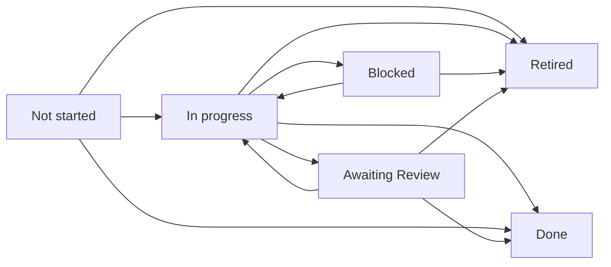

# Task Substrate & Operational Lifecycle Standard

The authoritative governance standard for managing operational tasks, sprint priorities, milestone groupings, and state transitions across **{{AIOS_NAME}}** and **{{BUSINESS_AIOS_NAME}}**.

---

## 1. Core Universal Laws

1. **Single Write Path:** Individual markdown files in `tasks/<slug>.md` are the single authoritative write path for all operational tasks. Derived dashboards such as [`TASKS.md`](../TASKS.md) and folder indexes such as [`tasks/tasks-index.md`](../tasks/tasks-index.md) are generated read projections; hand-editing them is strictly prohibited (ADR-0024, ADR-0025).
2. **Local-First & Multi-Tenant Isolation:** Tasks live directly in the local repository workspace. Personal substrate tasks reside in `{{REPO_PATH}}\tasks\`, while business domain tasks reside exclusively in `{{BUSINESS_REPO_PATH}}\tasks\`.
3. **Federated Read-Only Projection:** Root [`TASKS.md`](../TASKS.md) deterministically ingests and displays a read-only projection of {{BUSINESS_NAME}} business tasks alongside {{AIOS_NAME}} tasks, giving single-pane visibility without compromising multi-tenant write boundaries (ADR-0025).
4. **State vs. Event Distinction:** Tasks represent mutable operational state (`kind: state`). The file body and frontmatter status are updated in place during execution. Fast thought captures in [`capture/`](../capture/) are append-only events (`kind: event`) triaged into tasks.
5. **Deterministic Script Primacy:** All task queries, creations, completions, and index builds route through canonical PowerShell tooling in `scripts/` ([`New-Task.ps1`](../scripts/New-Task.ps1), [`Get-Tasks.ps1`](../scripts/Get-Tasks.ps1), [`Complete-Task.ps1`](../scripts/Complete-Task.ps1), [`Build-TasksIndex.ps1`](../scripts/Build-TasksIndex.ps1), [`Audit-Tasks.ps1`](../scripts/Audit-Tasks.ps1)).


---

## 2. The 2-Tier Priority Matrix

Tasks in `tasks/` are classified into exactly two operational tiers:

| Priority Tier | Scope & Intent | Cap / Limit | Review Cadence |
|---|---|---|---|
| **`Critical`** | Immediate operational blockers, active daily focus, or critical uncommitted debt. Human-only: never dispatched autonomously. | Strictly <=5 active items | Daily / Real-Time |
| **`High`** | Important near-term work: milestone deliverables and the next sprint. | Active Sprint Queue | Weekly Sprint Review |
| **`Medium`** | Default for new tasks: scheduled work without urgency. | Queue | Weekly Sprint Review |
| **`Low`** | Worth doing when capacity allows. | Backlog | Monthly |

**Deprecation of Someday:** Per {{OPERATOR_NAME}}'s architectural decision (2026-09-09), `Someday` is permanently deprecated from `tasks/`. Uncommitted thoughts remain in `capture/`, future phase strategy lives in `BUILD-PLAN.md`, and project backlogs live in `projects/<slug>/project.md`. A file in `tasks/` exists only if actively committed to near-term execution.

**Rule on Priority Inflation:** An agent must never place a task in `Critical` without explicit operator intent or an active system-blocking issue.

---

## 3. The 6-State Lifecycle Machine

Every task progresses through six formal lifecycle states:



1. **`Not started`**: Default initial state upon task creation.
2. **`In progress`**: Actively being worked on in the current session.
3. **`Blocked`**: Halted due to an external dependency, missing prerequisite listed in `blocked_by:`, or an unresolved mid-task question raised by the execution loop ([`workflows/execution-loop.md`](../workflows/execution-loop.md)).
4. **`Awaiting Review`**: Set only by the execution loop on an `autonomous: true` task. Work is finished and self-verified, but {{OPERATOR_NAME}} has not yet approved it. Transitions to `Done` on approval or back to `In progress` if he requests changes.
5. **`Done`**: Work is finished, falsifiable criteria are verified, and resolution is documented.
6. **`Retired`**: The task premise is invalidated by a later decision. Preserve its history, populate `retired_date` and `retired_reason`, and exclude it from active counts per [ADR-0055](../decisions/0055-task-retirement-lifecycle-and-milestone-decoupling.md).

---

## 4. Falsifiable "Done When" Verification Standard

Every active task must define 3 to 6 testable claims in its `## Done when` section naming the specific command, file, or observable condition proving completion:

- **Falsifiable Standard:** Every claim must be capable of failing. If a claim cannot fail, it is decorative and must be deleted.
- **Probe Naming:** Claims should explicitly reference scripts, exit codes, frontmatter keys, or UI endpoints.
- **Checklist Syntax:** Use standard markdown checkbox format (`- [ ] ...`).

---

## 5. Lightweight Resolution Schema

Upon task completion, [`scripts/Complete-Task.ps1`](../scripts/Complete-Task.ps1) updates `status: "Done"` and appends a standardized 3-field `## Resolution` block:

```markdown
## Resolution
- **Completed Date:** YYYY-MM-DD
- **Resolution Summary:** Dense explanation of what was built, fixed, or verified.
- **Durable Rule Promoted:** Rule or pattern promoted to memory/ or standards/ (or "None").
```

---

## 6. 14-Day Completion Archival & Retention Policy

To prevent directory bloat while preserving working context:

1. **14-Day In-Place Retention:** Tasks marked `Done` remain in `tasks/` for 14 days following completion so recent accomplishments remain visible in daily reviews and CLI queries.
2. **Automated Archival Sweep:** Tasks marked `Done` with a completion date older than 14 days are relocated to `archive/completed-tasks/<YYYY>/` by [`scripts/Archive-CompletedTasks.ps1`](../scripts/Archive-CompletedTasks.ps1).
3. **Git History as Permanent Ledger:** Per ADR-0010, the Git commit log remains the permanent immutable record of all completed tasks and system mutations.

---

## 7. Milestone Grouping & Federated Dashboard Standard

Per ADR-0025, operational tasks and root dashboards align with the following rules:

1. **Milestone Frontmatter Binding:** Tasks may declare `milestone: "M1" | "M2" | "M3" | "M4" | "Ops"` to link directly to strategic phases in [`BUILD-PLAN.md`](../BUILD-PLAN.md). Structural tasks (`scope: structural`) should declare a milestone tag.
2. **Deterministic `TASKS.md` Compilation:** [`scripts/Build-TasksIndex.ps1`](../scripts/Build-TasksIndex.ps1) deterministically generates root [`TASKS.md`](../TASKS.md) with:
   - Executive Priority Radar (Mermaid state diagram + comparative tier counts table)
   - 🔴 Active Sprint Focus (`Critical` tier table with expanded live `Done when` checklists)
   - 🟡 Active Sprints by Milestone (`High` / `Medium` / `Low` tables grouped by M1, M2, M3, M4, and Ops)
   - 💼 {{BUSINESS_NAME}} Business Domain Tasks (Federated read-only table from `{{BUSINESS_REPO_PATH}}\tasks\`)
3. **Graceful Peer Fallback:** If the peer repository `{{BUSINESS_AIOS_NAME}}` is absent or unmounted, `Build-TasksIndex.ps1` renders personal tasks and outputs a graceful notice without failing.

---

## 8. Tooling & Automation Interface

| Action | Canonical Command |
|---|---|
| Query Active Tasks | `pwsh scripts/Get-Tasks.ps1 -Priority Critical` |
| Create New Task | `pwsh scripts/New-Task.ps1 -Name "Deploy telemetry" -Priority Medium -Scope structural` |
| Complete Task | `pwsh scripts/Complete-Task.ps1 -TaskFile "deploy-telemetry.md" -Resolution "Deployed."` |
| Audit Task Substrate | `pwsh scripts/Audit-Tasks.ps1` |
| Rebuild Task Indexes & Dashboard | `pwsh scripts/Build-TasksIndex.ps1` |
| Sweep Completed Tasks | `pwsh scripts/Archive-CompletedTasks.ps1 -DaysOld 14` |


---

## 9. Delegation Gate & Execution Lanes

Per [ADR-0065](../decisions/0065-task-lifecycle-consolidation-and-delegation-gate.md). Every task carries `lane:`, assigned by [`scripts/Test-TaskGate.ps1`](../scripts/Test-TaskGate.ps1) at creation ([`New-Task.ps1`](../scripts/New-Task.ps1) calls it) and re-checkable any time. The gate is the operational form of "{{AIOS_NAME}} matches or exceeds {{OPERATOR_NAME}}'s quality with 90%+ confidence": a model cannot compute a calibrated probability, so autonomy requires five falsifiable checks, and the 90% is then measured as an outcome.

| Gate | Passes when | Failure routes to |
|---|---|---|
| **G1 Falsifiable Done when** | 3 to 6 claims, most naming a probe (command, file, exit code, observable state) | `grill` |
| **G2 Quality codified** | Quality is judged by a probe or an existing standard; no open taste or decision | `grill` |
| **G3 Autonomous per INTENT** | [`INTENT.md`](../INTENT.md) level is `autonomous` (no money, outbound messages, {{BUSINESS_NAME}} writes, logins, destructive ops) | `draft` |
| **G4 Digital & reachable** | Every input is on disk or behind a connected tool; no physical or human-only action | `operator` |
| **G5 Right-sized** | Effort Low/Medium, one subsystem, at most 5 files | `aios` instead of `hermes` |

Resolution order: G4, then G3, then G1/G2, then G5. All pass and small/mechanical: `hermes`; all pass otherwise: `aios`. `autonomous: true` is derived: lane `hermes`/`aios`, no `blocked_by`, and `scope: structural` (personal tasks still need explicit opt-in per ADR-0048). Results the heuristics cannot decide go to `tasks/_staged/review-queue.md`, never silently applied.

**Grill protocol.** Lane `grill` triggers a `/grill-me` capped at 3 questions, each aimed only at the failing gate. Answers are written into `## Done when`, the gate re-runs, and the task continues in its new lane.

**Measured confidence.** Sending an `Awaiting Review` task back runs `Invoke-TaskManagement.ps1 -Action Bounce`, incrementing `bounces:`. `Test-TaskGate.ps1 -Report` computes the send-back rate per lane and energy type; any group with 5+ samples above 10% is flagged for demotion to `grill`.

**Hermes dispatch.** `hermes` tasks reach the Hermes kanban only through [`scripts/Send-TaskToHermes.ps1`](../scripts/Send-TaskToHermes.ps1) in explicit batches from `/next-action`; `-Sync` returns finished cards to `Awaiting Review`, and every card is independently verified before approval.
