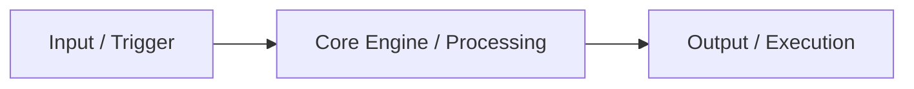

# {{Title}}

> **Source:** [{{URL}}]({{URL}}) · **Creator:** [{{Creator Name}}](../../creators/{{creator-slug}}.md) · **Date:** {{Date}} · **Transcript:** `transcript.txt`

```
Signal Score: {{Signal %}} fluff pruned · {{Duration}} ({{Raw Words}} words) condensed into {{Summary Words}} high-density words ({{Multiplier}}x compression) · 0 image tokens burned
Watch-Worthiness: {{Score}}/10 ({{Recommendation}}) · {{Watch Rationale}}
```

## ⚡ Executive Brief
2-3 sentence distillation of the video's core thesis, main takeaway, and practical utility. Include an optional Mermaid architecture diagram when the video describes a system, app, or workflow.



## 🎯 Key Moments Worth Watching (Clickable Jump Links)
Curated shortlist of the 2-4 exact moments worth seeing with your own eyes:
- [{{MM:SS}}](https://youtu.be/{{video-id}}?t={{seconds}}) - **{{Moment Title}}:** Why this specific timestamp is worth 60 seconds of visual viewing (e.g. UI layout, live benchmark, code demo).
- [{{MM:SS}}](https://youtu.be/{{video-id}}?t={{seconds}}) - **{{Moment Title}}:** Why this specific timestamp is worth watching.

## 🛠️ Technical Architecture Breakdown
Comprehensive, modular breakdown of the components, tech stack, frameworks, APIs, and code mechanisms demonstrated on screen:

1. **Component Name / Layer:**
   - **Technical Role:** What this component does in the system.
   - **Implementation Nuances:** Specific flags, libraries, file structures, or design decisions.
2. **Component Name / Layer:**
   - **Technical Role:** What this component does in the system.
   - **Implementation Nuances:** Specific flags, libraries, file structures, or design decisions.

## 🌶️ High-Value Insights & "The Sauce"
- 💡 [{{MM:SS}}](https://youtu.be/{{video-id}}?t={{seconds}}) **Insight Title:** Concrete tactics, configurations, prompt formulas, or unstated methods with clickable timestamps.
- 🔥 [{{MM:SS}}](https://youtu.be/{{video-id}}?t={{seconds}}) **Rare Finding:** Rare numbers, performance benchmarks, or edge-case workflows not widely documented.

## 🖼️ Extracted Prompts & Code Snippets
Copy-pasteable code blocks, system prompts, or terminal commands extracted directly from the video/OCR:

```text
# Extracted Prompt or CLI Command
```

## 🔗 Extracted Description Links & Resources
- **GitHub Repository:** [URL](URL) - Description of repo.
- **Referenced Tools / APIs:** [URL](URL) - Description.
- **Articles / Documentation:** [URL](URL) - Description.

## 💼 {{BUSINESS_NAME}} Commercial Application
How this video's demonstrated framework or technology can be packaged as a client offering, agency automation, or high-margin deliverable for {{BUSINESS_NAME}}:
- **Client Service / Offer:** Specific service package or workflow to productize.
- **Agency Leverage:** How {{BUSINESS_NAME}} internal operations can adopt this to cut turnaround times.

## 🔀 AIOS Delta & Actionability Routing

| Finding / Component | Verdict | Action for AIOS |
|---|---|---|
| **Concept A** | 🆕 New | Add new capability to memory or tasks. |
| **Concept B** | ⚔️ Contradicts | Update existing position (diff below). |
| **Concept C** | ✅ Confirms | Confirms existing knowledge (count only). |
| **Concept D** | 📎 Extends | Incremental depth added to existing standard. |

### Canon Patch Diff (if ⚔️ Contradicts or 📎 Extends)
```diff
--- a/memory/tools.md
+++ b/memory/tools.md
- Old position
+ New evidence-backed position
```

## 🚀 3-Step Implementation Plan
1. **Step 1:** First concrete action to build/apply this.
2. **Step 2:** Configuration / integration step.
3. **Step 3:** Execution / verification step.

## 📝 Personal Notes
<!-- Reserved for personal reflections or follow-ups -->

